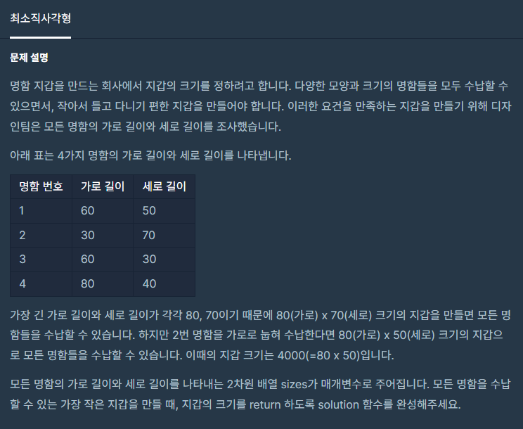

#### **#P. 30: 최소 직사각형 (난이도 : 중)**



```
public static int solution(int[][] arr) {
    // 배열에 인덱스 0, 1 에서 큰 값을 0으로 작은 값을 1로 옮긴다.
    // 그렇게 되면 돌렸을 때 넓이는 생각을 하지 않아도 된다.
    int temp=0;

    // 1. 자리 변경
    for(int i=0; i<arr.length;i++){
        if(arr[i][0] < arr[i][1]){
            temp = arr[i][0];
            arr[i][0] = arr[i][1];
            arr[i][1] = temp;
        }
    }

    // 2. 왼쪽 최대값  오른쪽 최댓값 찾기
    int lMax = Integer.MIN_VALUE;
    int rMax = lMax;

    for(int i=0; i<arr.length;i++){
        if(arr[i][0] > lMax) {
            lMax = arr[i][0];
        }
        if(arr[i][1] > rMax){
            rMax = arr[i][1];
        }
    }

    return lMax*rMax;
}
```
