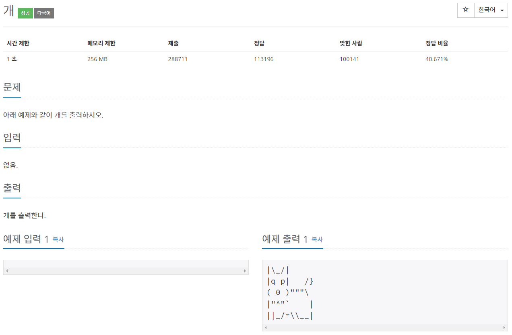
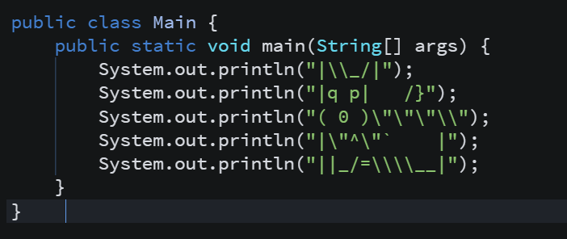
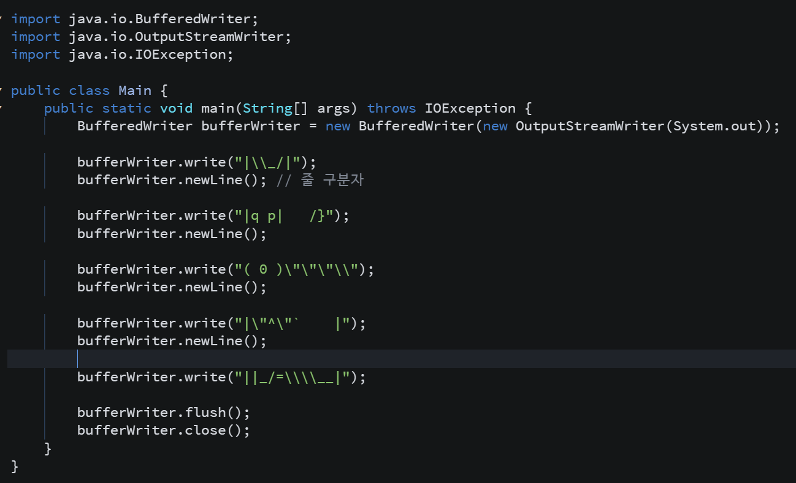
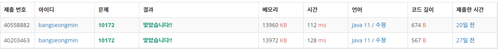

* **문제**

* **간략설명**

**1) 2가지 방법으로 풀이하였습니다. (풀이 방법은 10171번 고양이와 유사)**

**2) Escape **Sequance에 대해 알고 있어야 합니다.****

****[https://to-be-a-artist.tistory.com/8](tistory-8.html)****

* **풀이**

**- 방법 1 (System 클래스 이용)**

**- 방법 2(BufferedWriter)**

    - **실행결과**

* **정리**

**고양이 문제와 동일하여 BufferedWriter를 이용하여 해결하여 보았습니다. 방법은 유사하지만 가독성은 당연히 System 클래스를 이용하는 방법이 나은 것 같습니다. 그렇지만 **BufferedWriter를 이용하면 속도가 조금 더 빠른 것을 볼 수 있습니다.****
