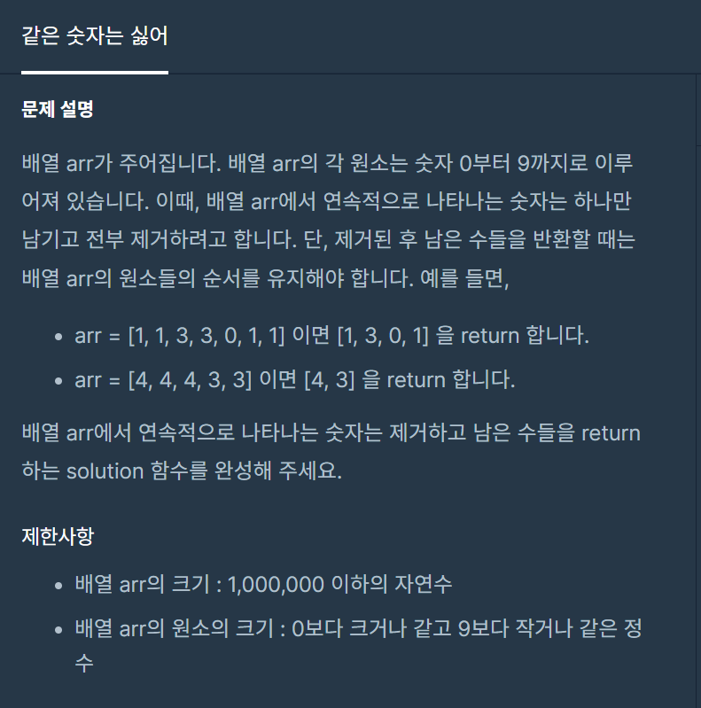

#### **#P. 31: 같은 숫자는 싫어 (난이도 : 중)**



프로그래머스 - 연습문제 : 같은 숫자는 싫어

* 풀이 방법  
  + 1. ArrayList을 이용한 풀이

```
public static int[] solution(int[] arr) {
    int[] answer = {};
    ArrayList<Integer> list = new ArrayList<Integer>();

    int value = -1;
    for(int i=0; i<arr.length;i++){
        if(arr[i] != value){
            list.add(arr[i]);
            value = arr[i];
        }
    }

    answer = new int[list.size()];
    for (int i=0; i<answer.length;i++){
        answer[i] = list.get(i);
    }

    return answer;
}
```
