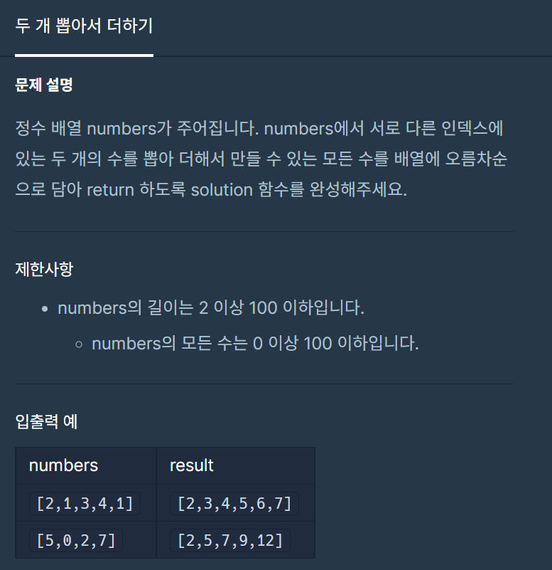

#### **#P. 32: 두 개 뽑아서 더하기 (난이도 : 중)**



프로그래머스 - 연습문제 : 두 개 뽑아서 더하기

* 풀이 방법  
  + 1. HashSet
  + 2. ArrayList
  + 3. 배열을 이용한 방법

```
public static int[] solution(int[] numbers) {
    // numbers의 길이는 2 이상 100 이하
    Set<Integer> set = new HashSet<>();
    Arrays.sort(numbers);
    for(int i=0; i<numbers.length-1;i++){
        for(int j=i+1; j<numbers.length;j++){
            int val = numbers[i] + numbers[j];
            if(!set.contains(val))
                set.add(numbers[i] + numbers[j]);
        }
    }

    return set.stream().sorted().mapToInt(i->i).toArray();
}

public static int[] solution2(int[] numbers){
    ArrayList<Integer> list = new ArrayList<>();
    for(int i=0; i<numbers.length;i++){
        for(int j=i+1; j<numbers.length;j++){
            int val = numbers[i] + numbers[j];
            if(!list.contains(val))
                list.add(numbers[i] + numbers[j]);
        }
    }
    Collections.sort(list);
    return list.stream().mapToInt(i->i).toArray();
}

public static int[] solution3(int[] numbers){
    int[] answer = new int[numbers.length+1];
    int idx = 0;
    for(int i=0; i<numbers.length;i++){
        for(int j=i+1; j<numbers.length;j++){
            int val = numbers[i] + numbers[j];
            if(Arrays.stream(answer).anyMatch(value -> value != val))
                answer[idx++] = val;
        }
    }
    Arrays.sort(answer);
    return answer;
}
```
