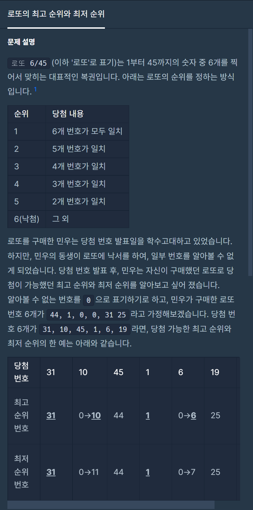

#### **#P. 33: 로또의 최고 순위와 최저 순위 (난이도 : 중)**



프로그래머스 - 2021-Dev-Matching:웹 백엔드 개발자 : 로또의 최고 순위와 최저 순위

* 풀이 방법  
  + 1. 배열과 반복문을 활용

```
public static int[] solution(int[] lottos, int[] win_nums) {
    int zero = 0;
    int match = 0;

    for(int nums : lottos){
        if(nums == 0) zero++;
        else {
            for(int w : win_nums){
                if(nums == w){
                    match++;
                    break;
                }
            }
        }
    }

    int min = match;
    int max = match+zero;

    return new int[]{Math.min(7-max, 6), Math.min(7-min,6)};
```
