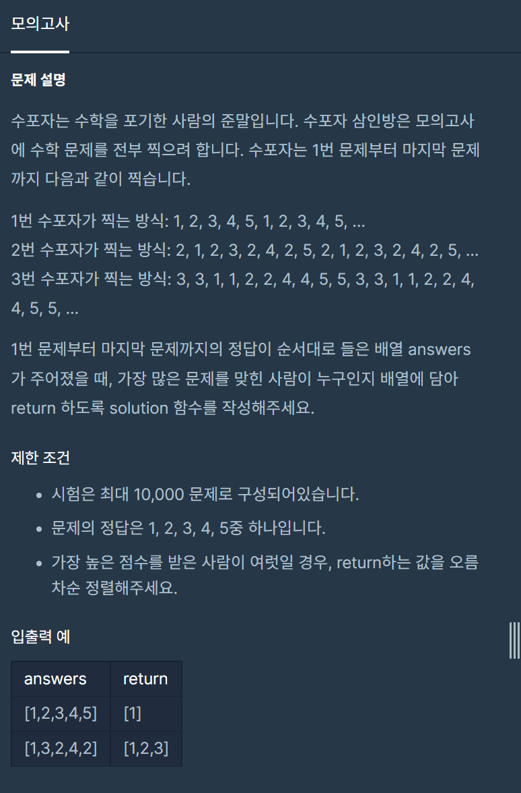

#### **#P. 34: 모의고사 (난이도 : 중)**



프로그래머스 - 완전탐색 :&nbsp;모의고사

* 풀이 방법  
  + 1. 패턴을 배열에 저장하여 반복문을 활용하는 방법

```
public static int[] solution(int[] answers) {
    int[] person1 = {1,2,3,4,5};
    int[] person2 = {2,1,2,3,2,4,2,5};
    int[] person3 = {3,3,1,1,2,2,4,4,5,5};
    int[] answer = new int[]{0,0,0};

    for(int i=0; i<answers.length;i++){
        if(person1[i%person1.length] == answers[i]) answer[0]++;
        if(person2[i%person2.length] == answers[i]) answer[1]++;
        if(person3[i%person3.length] == answers[i]) answer[2]++;
    }

    int max = Integer.MIN_VALUE;
    for(int i=0; i<answer.length;i++){
        if(answer[i] > max){
            max = answer[i];
        }
    }

    ArrayList<Integer> list = new ArrayList<>();
    for(int i=0; i<answer.length;i++){
        if(max == answer[i]){
            list.add(i+1);
        }
    }
    return list.stream().mapToInt(Integer::intValue).toArray();
}
```
