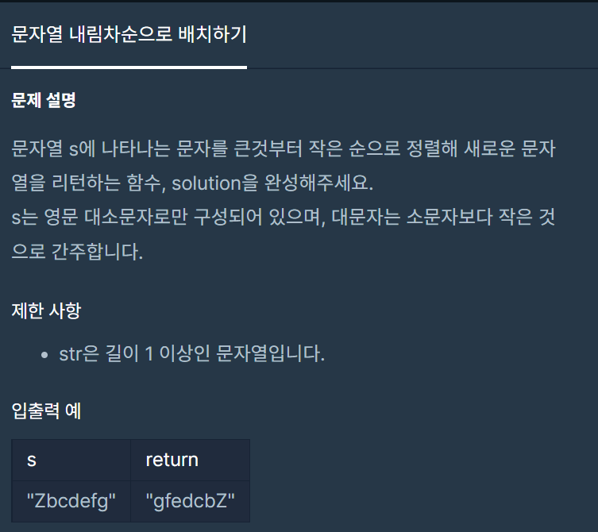

#### **#P. 36: 문자열 내림차순으로 배치하기 (난이도 : 중)**



프로그래머스 - 연습문제 :&nbsp;문자열 내림차순으로 배치하기

* 풀이 방법  
  + 1.Array.sort를 이용한 방법

```
public static String solution(String s) {
    String[] str = s.split("");

    Arrays.sort(str, Comparator.reverseOrder());
    StringBuilder sb = new StringBuilder();
    for (String c: str) {
        sb.append(c);
    }
    return sb.toString();
}
```
