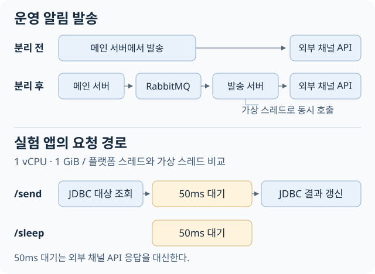

플랫폼 스레드에서 동기 호출을 하면 응답이 올 때까지 그 스레드는 다른 요청을 처리하지 못한다. 가상 스레드는 대기하는 동안 자신을 실행하던 플랫폼 스레드인 **캐리어 스레드**를 돌려줄 수 있다. 그동안 캐리어는 다른 가상 스레드를 실행한다. 이 차이로 같은 자원에서 초당 더 많은 요청을 처리할 수 있는지 궁금했다. [Java 가상 스레드 가이드](https://docs.oracle.com/en/java/javase/21/core/virtual-threads.html)

## 50ms 대기부터 시작했다

1. 부하 생성기가 같은 수의 요청을 동시에 보냈다. 앱에는 운영 환경에서 가져온 1 vCPU·1 GiB 제약을 걸고, 같은 요청을 플랫폼 스레드와 가상 스레드로 각각 처리했다.
2. `/sleep`은 앱 안에서 50ms를 기다린다. `/send`는 그 대기 앞뒤에 DB 조회와 갱신을 넣었다. 두 경로를 비교하면 대기만 있을 때 보인 차이가 DB를 거쳐도 나타나는지 볼 수 있다.
3. DB에 접근할 때 Java 앱은 표준 API인 **JDBC**를 사용한다. 실제로 MySQL 서버에 연결해 SQL을 보내고 응답을 읽는 코드는 앱에 포함된 **MySQL Connector/J** 드라이버가 맡는다. [MySQL Connector/J 공식 문서](https://dev.mysql.com/doc/connector-j/en/connector-j-overview.html)

첫 실험에서 대기만 하는 경로는 동시 요청이 많아지자 가상 스레드의 처리량이 더 높았다. DB를 거치는 경로에서는 가상 스레드의 처리량이 오히려 떨어졌다. DB 응답을 기다리는 동안 가상 스레드가 캐리어를 붙잡는 **pinning**이 원인일 수 있다고 보고, JDK와 앱 안의 드라이버를 각각 바꿔 확인했다. [첫 실험 기록](https://github.com/Elian-bang/virtual-thread-lab)

## 재측정 환경과 TPS 집계 기준

| 항목 | 실험 환경 |
|---|---|
| 애플리케이션 | Spring Boot 3.3.4, 1 vCPU · 1 GiB |
| Tomcat | 플랫폼 스레드 최대 200개 |
| 데이터베이스 | MySQL 8.0.46, 별도 컨테이너에서 실행 |
| 부하 생성기 | 응답이 돌아올 때마다 다음 요청을 보내 동시 요청 수를 일정하게 유지 |

첫 측정에는 측정창이 닫힌 뒤 끝난 요청까지 TPS에 포함하는 문제가 있었다. 캐리어가 붙잡힌 위치를 확인할 JFR 스택도 남기지 못했다. 두 번째 실험에서는 워밍업 30초, 측정 60초로 고정하고 창 안에서 완료된 요청만 집계했다. 47개 조건을 매 반복마다 섞어 5회씩, 총 235회 실행했다. 아래 수치는 각 조건의 중앙값이다. [사전 설계](https://github.com/Elian-bang/virtual-thread-lab/blob/main/docs/%EC%84%A4%EA%B3%84-v2.md) · [반복별 원자료](https://github.com/Elian-bang/virtual-thread-lab/blob/main/results/v2/runs.csv)

## 50ms 대기 경로의 동시 요청별 처리량

| 동시 요청 | 플랫폼 스레드 TPS | 가상 스레드 TPS |
|---:|---:|---:|
| 100 | 1,906.9 | 1,847.0 |
| 500 | 3,552.7 | 6,878.1 |
| 2,000 | 3,572.9 | 6,049.7 |

동시 요청이 100개일 때는 두 모델의 처리량이 비슷했다. 500개에서는 가상 스레드가 플랫폼 스레드보다 초당 약 1.9배 많은 요청을 처리했다. 2,000개로 늘렸을 때 플랫폼 스레드의 처리량은 500개일 때와 거의 같았고, 가상 스레드는 500개일 때보다 처리량이 줄었지만 여전히 플랫폼 스레드보다 높았다. 동시 500과 2,000에서 실행별 플랫폼 스레드 최대치를 모아 중앙값을 구하면 플랫폼 스레드 모델은 219개, 가상 스레드 모델은 22개였다. 이 수에는 JVM 내부 스레드도 포함된다. [v2 결과](https://github.com/Elian-bang/virtual-thread-lab/blob/main/results/%EA%B2%B0%EA%B3%BC-v2.md)

## JDK와 MySQL 드라이버를 하나씩 바꿨다

동시 100, 커넥션 풀 50, 애플리케이션 락 없이 `/send`를 실행했다. 가상 스레드는 대기 중에 캐리어 스레드를 비울 수 있지만, pinning이 발생하면 그동안 캐리어가 다른 가상 스레드를 실행하지 못한다.

| JDK | Connector/J | 플랫폼 스레드 TPS | 가상 스레드 TPS | 가상 스레드 JFR pinning 누적 시간 |
|---|---|---:|---:|---:|
| 21 | 8.3.0 | 1,335.0 | 81.5 | 약 55,039ms |
| 21 | 9.7.0 | 1,329.5 | 1,265.2 | 0ms |
| 25 | 8.3.0 | 1,333.0 | 1,284.6 | 0ms |
| 25 | 9.7.0 | 1,328.1 | 1,278.9 | 0ms |

기준 조합의 JFR 이벤트에는 Connector/J의 `ReadAheadInputStream`을 거쳐 소켓을 읽는 스택이 남았다. 기준 조합에서 설정상 50ms였던 대기 구간은 앱에서 평균 614.1ms로 관측됐다. JDK나 드라이버 중 하나만 바꿔도 TPS 격차가 약 16.4배에서 1.04~1.05배로 좁혀졌고, 측정창의 pinning 이벤트는 관측되지 않았다. Connector/J 9.0의 락 변경과 JDK 24에 반영된 JEP 491이 각각 이 방향을 뒷받침한다. 가상 스레드는 JDK 21에서 정식 도입됐고, 이 실험에서는 pinning 개선이 반영된 JDK 25를 JDK 21과 비교했다. MySQL 서버 버전은 8.0.46으로 고정했다. [JFR과 비교 결과](https://github.com/Elian-bang/virtual-thread-lab/blob/main/results/%EA%B2%B0%EA%B3%BC-v2.md) · [Connector/J 릴리스 노트](https://dev.mysql.com/doc/relnotes/connector-j/en/news-9-0-0.html) · [JDK 24의 JEP 491](https://docs.oracle.com/en/java/javase/24/migrate/significant-changes-jdk-24.html)

## 동시 요청 1,000개에서 발생한 행 락 경합

동시 1,000의 JDBC 경로는 부하 생성기 때문에 작업자들이 같은 순서로 같은 행을 갱신했다. 기준 조합의 플랫폼 스레드 모델에서 행 락 대기 누적 시간은 동시 100의 약 452초에서 약 4,578초로 늘었다. 여러 연결의 대기를 합한 값이다. 이 구간에서는 행 락 경합이 스레드 모델의 차이를 가릴 수 있어 위 비교의 근거에서 제외했다.

## 대기하는 동안 캐리어를 돌려줄 수 있어야 했다

대기만 있는 경로에서는 동시 요청 500개에서 가상 스레드가 약 1.9배 많은 요청을 처리했다. JDBC가 포함된 경로에서는 JDK나 Connector/J를 바꿔 pinning이 사라진 조건에서도, 동시 요청 100개 기준 처리량은 플랫폼 스레드와 비슷했다. 같은 자원에서 외부 응답 대기를 효율적으로 처리할 수 있다는 기대는 대기만 있는 경로에서 확인했고, JDBC가 포함된 경로의 처리량은 별도로 봐야 했다.

다음 실험에서는 작업자마다 다른 행에서 갱신을 시작하도록 부하 생성기를 바꾼 뒤, 동시 요청 1,000개에서 행 락 대기와 처리량을 다시 비교할 계획이다. [실험 저장소](https://github.com/Elian-bang/virtual-thread-lab)
